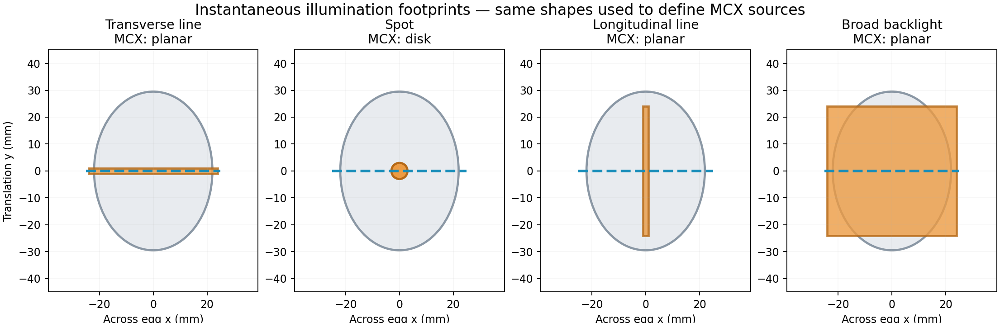

# Egg transmission simulator — v0.9 (MCX)

**Python · Streamlit · MCX photon transport through `pmcx` · pushbroom line-scan or stationary 2D area camera**

This project investigates whether a transmitted-light hyperspectral camera can recover spatial structures (e.g. yolk boundary, synthetic blood inclusion) in a moving egg. The project now uses **MCX/PMCX exclusively for the Monte Carlo photon transport**. The previous self-written Monte Carlo kernel was removed from the active simulation path.

> **Scientific status:** The **transport solver is established** (MCX), but this **egg/instrument model is *not* experimentally validated**. The 800 nm albumen and yolk optical properties are literature anchors; the shell, blood and refractive indices are illustrative defaults. At wavelengths other than 800 nm, the default properties **do not change** unless a CSV with measurements is supplied. A real camera lens, spectrograph, shell microtexture and measured 150 W SCHOTT emitter beam profiles are *not* modeled.

## Install with Conda (Windows / NVIDIA GPU)

```powershell
conda create -n eggtrans python=3.11 -y
conda activate eggtrans
cd path\to\egg_transmisison
python -m pip install -r requirements.txt
python -m pip install pytest
python -c "import pmcx; print(pmcx.gpuinfo())"
python -m streamlit run app.py
```

**PMCX package version:** requires `pmcx>=0.8.1,<0.9` (not the nonexistent `pmcx>=2025.10`). After pulling repository updates, run `python -m pip install -r requirements.txt` again. Check the runtime with `python -m eggtrans.verify_physics` on your GPU.

**PMCX needs a compatible NVIDIA CUDA GPU** for its standard binary backend; NVIDIA drivers must be installed. The pip wheel typically includes the CUDA runtime, so a full CUDA toolkit is normally unnecessary. Without an operational MCX backend, the application can show its geometry schematic but **will not silently switch to a home-built ray tracer**. For Intel/AMD/OpenCL machines, MCX-CL/`pmcxcl` may be suitable as an additional future backend, but it is not wired or verified in this version.

## Camera modes

The Streamlit main page offers **Camera type: Pushbroom (line scan)** or
**Normal camera (2D area)**. Both rely exclusively on the established MCX
photon transport engine through PMCX; only the detector readout and source
movement differ.

| | Pushbroom | Normal 2D camera |
|---|---|---|
| Motion | Egg translates under fixed light and camera line | Egg and source stay stationary |
| MCX runs | One per successive y scan line | **One** per exposure |
| Detector | x histogram within y slit | 2D y/x histogram over entire field |
| MCX source | Native disk or planar source at each scan position | Same native disk or planar source, fixed |
| Typical spot result | May form a stripe after stacking scan lines | Localized 2D transmission footprint, blurred by scattering |
| Camera geometry | Idealized directional line receiver | Idealized telecentric-like 2D receiver |

The blue overlay in the interactive apparatus schematic changes from a
**horizontal camera line** to a **rectangular field of view**. The new mode
is an area image at **one wavelength**, not a snapshot hyperspectral sensor.

For a quick spot-vs-line comparison choose **Normal camera (2D area)**,
then **Compare spot vs transverse line**. Keep the photon budget equal; the
sources have very different illuminated areas, so equal photon counts should
not be confused with equal irradiance at the egg.

Command-line examples:

```powershell
python -m eggtrans.cli --camera Area --mode Spot --photons 1000000 --area-rows 96 --pixels 96 --output results/area_spot
python -m eggtrans.cli --camera Area --mode "Transverse line" --photons 1000000 --area-rows 96 --pixels 96 --output results/area_line
python -m eggtrans.cli --camera Pushbroom --mode Spot --photons 100000 --lines 48 --output results/scan_spot
```

## v0.9: exclude photons that bypass the egg

**Why the egg sides look missing:** The source illuminates a finite x footprint
(a 48 mm line is only 2 mm wider per side than the default 44 mm egg), and
bright unattenuated air paths dominate the raw detector colour scale. The
egg boundaries are geometric ground truth, not necessarily contours in
measured transmitted light. Filtering bypass light may improve visibility
but cannot restore photon-starved side pixels.

**New Streamlit camera setting:** `Detector photon-history filter`:

| Mode | MCX photon paths accepted |
|---|---|
| **All exits** | All photons passing camera angle/FOV/slit filters, including air-only bypass |
| **Traversed egg** (default) | Partial MCX path through shell, albumen, yolk or blood |
| **Traversed interior** | Path through albumen, yolk or blood; rejects shell-only grazing paths |

The adjustable `Minimum path inside selected egg region (mm)` rejects
histories below a chosen material path length. Set it to **0 mm** to include
any positive path through the selected egg region. The filter uses official
MCX `detp.ppath`, written by `savedetflag='DPXV'`. Those lengths are
stored in **voxel units**; they are multiplied by `voxel_mm` for thresholding.
For detected-photon weights, the official
`pmcx.detweight(detp, prop, unitinmm=voxel_mm)` is now called with explicit
voxel size, correcting the previous absorption scaling when the detector
record did not include that metadata.

The program preserves the original `image_unfiltered` alongside the
selected `image`. In Streamlit, **Compare detected light BEFORE and AFTER
direct-path filtering** shows a shared-scale comparison from the same
MCX run. The downloaded NPZ contains both images and the run metadata
reports excluded photons and energy.

**Important:** MCX photon-history selection is an *idealized diagnostic*,
not a physical camera. A real HSI or area camera cannot know which
detected photons passed through the egg. To suppress direct stray light
physically, build and validate a baffled source path, dark surrounding
enclosure, field stop and lens aperture; these optical components are
**not modeled** by the diagnostic filter. Do not describe the gated image as
the output of an actual optical baffle.

**For lateral coverage:** compare transverse lines of **48 mm and 60 mm**,
with matched launched energy, adequate padding and a sufficiently high
photon budget (start with at least 300,000 photons per scan line). A spot
source narrower than the egg cannot illuminate the entire egg width.
Inspect `All exits` and `Traversed egg` before deciding whether absent
sides are a camera artifact or truly weak transmitted light.

Local software tests verify gate medium indices, thresholds in mm,
missing-path failures, explicit PMCX voxel-unit weighting, and gated/raw
camera histograms in both modes. GPU physics tests must be executed on
your NVIDIA workstation (`python -m eggtrans.verify_physics` and
`RUN_MCX_PHYSICS=1 python -m pytest -q tests/test_mcx_physics.py`).

MCX reference documentation:
[detected photon partial paths](https://github.com/fangq/mcx/blob/master/README.md)
and [PMCX detweight implementation](https://github.com/fangq/mcx/blob/master/pmcx/pmcx/utils.py).

## v0.8: source-specific MCX domain and controlled camera comparison

### Fix for "MCX voxel domain too large"

The previous implementation allocated an axis-aligned air-filled simulation box using **the maximum of all possible source dimensions**, even those disabled by the chosen illumination setting. It also imposed an arbitrary 12-million-voxel limit. Consequently, a 2D spot at a long (inactive) line-length setting and the same source in pushbroom mode could require unnecessarily large boxes.

Now `eggtrans.mcx_engine.domain_plan()` sizes the volume from the **actual selected MCX source footprint**, the egg silhouette and camera field of view. In pushbroom mode it contains the union of source positions over all scan lines. A user-controlled **lateral air padding** surrounds this union so scattered photons have room to travel before escaping at the artificial side walls. The z clearance has not been changed. No change is made to the voxel resolution automatically. Standard MCX continues to handle all photon transport.

For the default 44 × 59 × 44 mm egg, 60 mm transverse illumination, 0.35 mm voxels and 8 mm padding:

| Scenario | Old grid voxels | New grid voxels |
|---|---:|---:|
| Transverse line, pushbroom | approximately 12.84 million | **7.53 million** |
| Spot, pushbroom (inactive line length=60 mm) | approximately 12.84 million | **6.60 million** |
| Spot, stationary 2D area camera | approximately 7.64 million | **6.14 million** |

These are **calculated grid geometries, not measured optical predictions**. The old limit was project-specific, not an MCX hard limit. The new preflight checks an adjustable **rough Python host-rasterization memory budget** (default 512 MiB, using 16 bytes per voxel to estimate peak mask/temporary working memory). The actual uint8 labels use about **one byte per voxel**; GPU working memory and per-photon exit records are additional, implementation- and hardware-dependent. Preflight uses only geometry and does not allocate the full volume on each Streamlit widget refresh.

**Important: shrinking the artificial box can affect MCX transport.** Scattered photons that escape a side boundary will not return. The 8 mm default is a starting point, *not* a verified optimal padding value. In Streamlit inspect the padding-cost table and run an actual GPU convergence study before trusting spatial contrast or total throughput:

```powershell
# No GPU required: exact box dimensions and memory estimates
python scripts/run_domain_convergence.py --dry-run --camera Pushbroom --mode "Transverse line" --voxel 0.35 --line-length 60 --padding 6 8 12 16

# Requires working PMCX/CUDA: real MCX simulations, at fixed 0.5-mm voxels
python scripts/run_domain_convergence.py --camera Area --mode "Transverse line" --voxel 0.5 --padding 8 12 16 --photons 300000 --output reports/padding_convergence.json
```

The results JSON includes integrated weighted signal and image-level differences relative to the largest box. **Monte Carlo noise can dominate these differences**, so repeat at higher photon budgets and multiple seeds if results are ambiguous. A small image difference at a single photon budget is *not* proof of convergence. Refining the uniform grid also does not make a 0.35-mm eggshell accurate until adequate resolution is established; split-voxel MCX or MMC are longer-term options.

### Matched camera comparison

The usual pushbroom and area-camera outputs are *different experiments* for spot/line illumination, so they need not look alike. A new Streamlit expander, **Diagnostic: matched broad-illumination acquisition**, runs an explicit **controlled, stationary-egg comparison**: one area image versus separate virtual camera rows, **both under a fixed broad light field relative to the egg** with matched row pitch, camera acceptance and source parameters. One MCX run is used for the area image and one additional MCX run per virtual row. Images are normalized **per launched photon packet in each run**. With sufficient detected photons they should agree statistically.

This controlled test does **not** reproduce an egg physically translated beneath a narrow lab-fixed source. It is complementary to **Diagnostic: compare detector readouts with identical photons**, which bins the exact same exiting photons into both detector representations and should agree almost exactly. Neither diagnostic substitutes for physical validation of moving-eggs or a matched measurement of actual source irradiance.

## Camera result overlays and interactive 3D projection

After running a simulation, use the three **Display overlays** switches to add:

- **Full egg outline:** orthographic silhouette of the input ellipsoid.
- **Yolk outline:** input yolk ellipsoid silhouette, including x/y offset (not shown if yolk disabled).
- **Illumination outline:** MCX **source launch footprint** at the input plane, before photons travel through the egg. This is *not* the transmitted illumination footprint or a recovered boundary.

All outlines default **off** and are added after photon transport. The camera heatmap is always the actual returned MCX detector histogram. Geometry overlays use the **saved inputs from the image calculation**: changing sliders without rerunning cannot move the overlays relative to the old result. For pushbroom acquisition, the **Show instantaneous source at scan line** slider chooses which source position to visualize; the finished pushbroom image includes all line positions.

**Interactive 3D view** displays a translucent ellipsoidal egg, optional yolk, one instantaneous 3D source footprint at the source plane, and the simulated camera image mapped to a flat upper detector plane. The camera output is a 2D image, *not* a reconstruction of the interior. In pushbroom mode, the image is an **assembled scan from multiple times**; the displayed source is **one selected instant**. The view is therefore an explanatory composite, not a frozen simultaneous physical scene. The 3D viewer has independent visibility switches for the egg envelope, yolk, source, and camera output plane, initially enabled so the full scene is visible. Turn off **3D: camera output** to see the interior more clearly. The 3D egg envelope does not resolve the actual submillimetre shell thickness.

The renderer uses Plotly for all graphics and uses no custom transport, ray-tracing, or inference algorithms. The output color plane is made from actual MCX image values; it is never synthesized from the egg/yolk geometry.

## Camera readout consistency check

The ordinary pushbroom and area experiments are *not* directly comparable when illumination is spatially localized. In pushbroom mode, a fixed source and camera slit move relative to the egg. A spot makes a line-like strip across the completed scan; a stationary area camera captures a local spot. Broad backlighting may produce more similar images when the illuminated area covers the full translation range and the camera sampling/throughput are matched.

The Streamlit expander **Diagnostic: compare detector readouts with identical photons** runs **one** MCX simulation with a fixed scene and then bins the *identical exiting photons* using both an area detector and a virtual line detector with one area-row-width slit. The resulting 2D images should agree. This tests readout binning but does **not** test moving geometry or validate the MCX physics engine.

## Voxel size and the 0.35 mm eggshell

Standard MCX label volumes use a **uniform isotropic grid**: the same voxel size applies to the egg interior, thin shell, and air. The Streamlit selector now offers **0.20, 0.25 and 0.35 mm** in addition to coarser values. At 0.35 mm a nominal 0.35 mm shell spans only one voxel; at 0.20 mm it still spans fewer than two. The formerly hard-coded 12-million-voxel cap is removed; an adjustable host-memory budget now blocks oversized rasterization. A finer grid may still exceed GPU memory, and it must be evaluated independently for interface accuracy.

Established sub-voxel/mesh alternatives: [MCX split-voxel SVMC](https://pmc.ncbi.nlm.nih.gov/articles/PMC7687934/) for curved interfaces and [MMC](https://github.com/fangq/mmc) with tetrahedral meshes. Neither is connected to this project yet; do not claim locally adaptive voxels in standard MCX. A shell thinner than a coarse voxel may contain both surfaces in a single voxel, which is problematic even for simple split-voxel representations.

## Source geometries: important spot/line distinction

In **pushbroom mode**, the camera observes a fixed horizontal line x across the egg. The egg translates along y. A fixed light source beneath the camera appears to move along the egg in the egg-relative reference frame.

| Selection | Native MCX `srctype` | Instantaneous footprint on underside of egg |
|---|---|---|
| **Spot** | `disk` | Circular disk of user-specified diameter |
| **Transverse line** | `planar` | Long in x, narrow in y (perpendicular to translation) |
| **Longitudinal line** | `planar` | Narrow in x, long in y (parallel to translation) |
| **Broad backlight** | `planar` | Square area in xy |



Both the *launch parameters* and the *Streamlit top-view schematic* use `source_footprint_mm()` as a single source of truth. Tests assert the type, size, orientation and y displacement of each illumination mode.

**Why a spot can look like a line in a pushbroom reconstructed image:** at every scan position the spot illuminates approximately the same x region of the **moving** egg. Stacking measurements of its successive y positions can therefore create a **longitudinal bright stripe**. This is expected with a pushbroom scan and does not in itself indicate the wrong light source. The schematic independently shows the **instantaneous** circular spot.

The MCX source focus uses the documented native planar/disk focusing parameter (`srcdir[3]`): zero = collimated, negative = diverging, positive = converging. Unlike the original custom simulator, the interface no longer advertises independently configurable x/y divergence; MCX's native focal setting does not guarantee those controls. A narrow source is not necessarily an angularly collimated one.

## Transport and camera model

1. `eggtrans/mcx_engine.py` voxelizes nested ellipsoids into **nonzero** MCX volume labels: air=1, shell=2, albumen=3, yolk=4, blood=5. The exterior/background row 0 and air row 1 both have air properties. Shell thickness is only approximately represented by voxelization.
2. In pushbroom mode, each scan line produces an **MCX native disk/planar** source at that scan position; in area mode a **single static MCX run** is used; `pmcx.mcxlab(cfg)` performs **all** scattering, absorption, Fresnel/refraction and photon transport.
3. MCX records photons leaving the **+z simulation box face** (via MCX `bc='______000001'`, save exit positions and directions). This is a transmission-detection surface, not internal fluence.
4. The project applies only a **geometrical pixel readout** to those recorded exit photons: accept ray directions within the camera half-angle, then either restrict to the moving y slit and bin x (pushbroom), or bin all accepted x/y photons into a 2D image (area camera). Photon weights are computed by `pmcx.detweight(..., unitinmm=voxel_mm)` rather than a local Beer–Lambert implementation; the camera's optional diagnostic path gate uses MCX material path records.
5. The result is one spatial 2D image per wavelength. A complete HSI cube requires repeating with measured optical coefficients at every wavelength.

**Camera approximation:** Both modes use idealized telecentric/angular-gated detection at the upper MCX box face; the area camera does not apply an observation slit. It does not trace the real camera lens or model numerical aperture, aperture stop, PSF, slit throughput, sensor sensitivity or shot/read noise. One 1 mm voxel near a 0.35 mm shell is *not* sufficient to resolve shell geometry; prefer a finer grid or later migrate to MCX split-voxel media.

**Source normalization:** images are reported per launched photon packet; a 150 W lamp does **not** automatically translate to absolute irradiance or wavelength-dependent brightness. Separate the spot/line irradiance, angular emission and spectral power when comparing hardware.

## Reference tests — two independent physical expectations

The project includes two tests that **actually call PMCX**, rather than verifying a custom implementation against itself:

**1. Beer–Lambert slab in transmission:** non-scattering, index-matched slab of thickness **12 mm**. For the independent values μa = 0, 0.03 and 0.10 mm⁻¹, expected total transmission is `exp(-μa × 12 mm)`. MCX must produce those exit-weight fractions within 4.5% relative tolerance.

**2. Transparent source footprints:** no egg, no absorption, no scattering, perfectly collimated. A **native MCX disk** must project a nearly circular spot (x/y standard-deviation ratio 0.85–1.15). A **native MCX planar stripe** must produce a long transverse line (x/y ratio >10). These tests detect a spot accidentally being configured as a line.

Run the actual MCX physics checks on a CUDA-equipped machine:

```powershell
conda activate eggtrans
python -m eggtrans.verify_physics
# Or using pytest:
$env:RUN_MCX_PHYSICS = '1'
python -m pytest -q tests/test_mcx_physics.py
```

For the rest of the software tests (no GPU needed):

```powershell
python -m pytest -q
```

**Test status, November 2026:** The backend-independent configuration, geometry, source and readout tests pass locally. GPU transport and the analytical slab tests were **not executed in the authoring environment**, because neither PMCX nor a supported GPU was available. The MCX test file is intentionally skipped without `RUN_MCX_PHYSICS=1`. The above commands are provided so you can run the definitive engine checks on your workstation. No fictitious transport validation or simulated camera images are reported.

## Known optical properties

At 800 nm only, albumen and yolk values are derived from Tamura et al. (2026) as used in the previous version:

| Region | μa (mm⁻¹) | μs (mm⁻¹) | g |
|---|---:|---:|---:|
| Albumen | 0.006 | 0.069 | 0.90 |
| Yolk | 0.014 | 5.350 | 0.92 |

The shell and synthetic blood parameters and *all* default refractive indices are illustrative assumptions. A wavelength selector without a property CSV does not change these coefficients and should not be interpreted as a real 1200/1500 nm prediction.

CSV schema:

```csv
wavelength_nm,material,mu_a_mm_1,mu_s_mm_1,g,n
```

Provide **Shell**, **Albumen**, **Yolk**, **Blood spot** rows for each wavelength; interpolation only, never extrapolation. Air is fixed analytically.

## Files

- `app.py`: Streamlit UI and plots
- `eggtrans/core.py`: egg geometry, shared dataclasses, and public entry point only (**no custom photon transport**)
- `eggtrans/mcx_engine.py`: PMCX configuration, voxel-label setup, photo exit-face readout, known-answer phantoms
- `eggtrans/schematic.py`: interactive top/side views tied to MCX source parameters
- `eggtrans/readout_validation.py`: MCX photon-exit detector equivalence check, without custom optical transport
- `eggtrans/acquisition_comparison.py`: controlled broad-source comparison (one MCX run per camera exposure/virtual row)
- `scripts/run_domain_convergence.py`: voxel-domain preflight and optional real MCX padding-convergence runs
- `eggtrans/visualization.py`: 2D image overlays and conceptual interactive 3D plot, without any photon transport
- `eggtrans/verify_physics.py`: execute the reference phantoms using real MCX
- `eggtrans/spectra.py`: measured spectral CSV support
- `eggtrans/cli.py`: batch run using same MCX entry point
- `eggtrans/mcx_export.py`: export inspectable **PMCX** inputs sharing the same source definitions; not a second transport engine
- `tests/`: source geometry, mapping, pushbroom/area camera readout and optional GPU MCX reference tests

Previous illustrated reports under `reports/` are retained as **historical v0.1–v0.3 results generated with the *retired custom* kernel**, not as new MCX predictions. Historical illumination batch scripts (where present) are not MCX results; use the new Streamlit app, `python -m eggtrans.cli`, or `scripts/run_domain_convergence.py` for current MCX work.

## Primary open-source sources

- [MCX: Fang & Boas (2009), GPU-accelerated Monte Carlo photon transport](https://doi.org/10.1364/OE.17.020178) and [MCX repository / current documentation](https://github.com/fangq/mcx)
- [PMCX: official Python bindings](https://pypi.org/project/pmcx/)
- [MCX source types and upper-face detectors](https://github.com/fangq/mcx/blob/master/mcxlab/README.txt)
- [Tamura et al. (2026), egg optical properties](https://doi.org/10.1016/j.jfoodeng.2026.113182)
- [PyXOpto](https://github.com/xopto/pyxopto) is another established alternative but is not used here; mixing two transport engines would make validation and reproducibility more complex.
