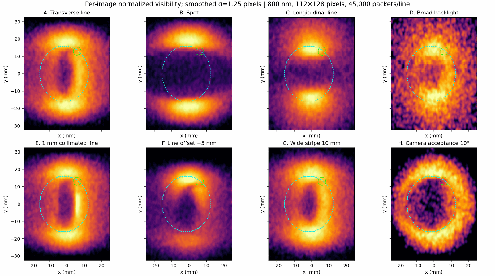
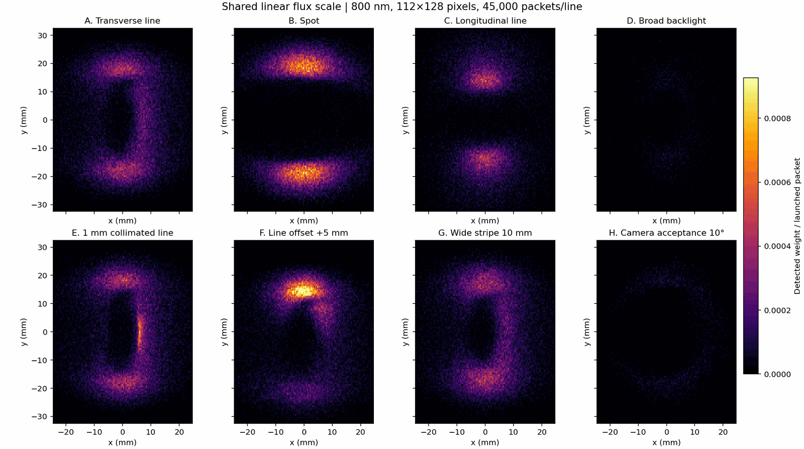
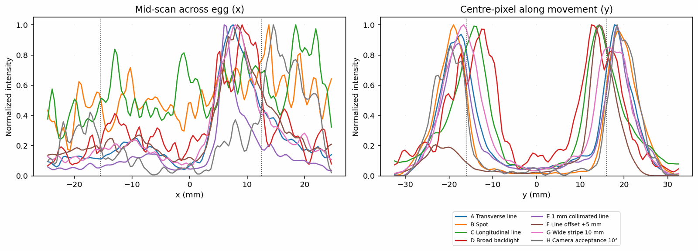

# Egg transmission: illumination-geometry comparison at 800 nm

**19 November 2026 · Reproducible simulation note · v0.1 model (unvalidated)**

> **Scope.** Eight optical configurations simulated with the existing Python/Numba 3D Monte Carlo engine in this repository. These are **hypothesis-generating simulation results**, not experimentally validated images or a measurement of real yolk / blood-spot boundaries.

## Main findings

1. **The yolk produces a broad, strongly geometry-dependent dark shadow, not a precise projection of its boundary.** A visually sharp change in signal is not necessarily an anatomically accurate contour. The dashed cyan circle/ellipse in the enhanced figure is the *known simulated ground truth*, not an automatically recovered boundary.
2. **Spot (B) vs transverse line (A):** the spot produces modestly more detected weighted signal (1.054% versus 0.926% of launched packet weight) but has a smaller zero-volume-scatter contribution (0.29% versus 1.44% of the detected signal). More throughput does not guarantee preservation of fine spatial detail.
3. **Narrow + collimated line (E) vs baseline (A):** the changes in total flux (0.937% vs 0.926%) and zero-scattering share (1.38% vs 1.44%) are minor in this particular model; the predicted outline is **not dramatically sharper**. Importantly, E changes **both** stripe width (2 → 1 mm) and illumination angular spread (8°/3° → 1°/1°), so this is **not a controlled single-factor test of collimation**.
4. **Offset line (F):** the source–camera offset changes which parts of the projected yolk shadow appear bright. Its zero-scatter fraction increases (3.02% vs 1.44%), but this is **not evidence of superior anatomical accuracy**; refraction and sampling geometry matter.
5. **Broad backlight (D):** very low detected signal for the same launched photon *budget* (0.108%). The 110 mm square emission aperture spreads the packets over a much larger area than the 48 × 2 mm line. This should **not** be interpreted as broad backlighting being intrinsically inefficient at the same *irradiance on the egg*.
6. **Narrow receiver acceptance (H):** 10° instead of 40° reduces the detected flux from 0.926% to 0.123%, and the zero-scattering percentage **decreases** in this simplified curved-shell/receiver model. A small angular acceptance is therefore not automatically a useful ballistic-photon filter without a realistic camera-pupil model.
7. **Blood spot:** with this synthetic 2.3 mm-radius inclusion and *illustrative* blood absorption, the image does not convincingly reproduce a localized true spot shape. No blood-spot detection claim is made.

## Simulation parameters

- **Wavelength:** 800 nm only. The non-800-nm optical curves needed for a quantitative 400–1700 nm simulation are **not yet available** in this project.
- **Camera output:** **112 pushbroom scan lines × 128 cross-line pixels** (versus 64 × 72 in the original demo), with **45,000 launched photon packets per line** = **5,040,000 per configuration** (40,320,000 total).
- **Specimen:** synthetic ellipsoidal egg, 44 mm width × 59 mm length × 44 mm height; 0.35 mm smooth shell; ellipsoidal yolk of radii 14 × 16 × 14 mm, slightly offset; optional 2.3 mm-radius artificial blood spot.
- **Source and detector:** idealized source 2 mm below the egg, idealized top-plane receiver 1 mm above it; typical input ray slope standard deviations **8° along x and 3° along travel y**, camera acceptance half-angle **40°**, camera line gate width 4 mm, unless specified below. **This is not a ray-traced SCHOTT cylindrical-lens system or a calibrated pushbroom lens/spectrograph.**
- **Optical properties:** at 800 nm, albumen and yolk coefficients (absorption, scattering and HG anisotropy) are taken from the values attributed to Tamura et al. (2026) in the repository. **Shell, blood-spot and refractive-index coefficients are illustrative placeholders.**
- **Numerics:** custom Numba Monte Carlo, 900 scattering/boundary events maximum per packet, pseudorandom seed 711, full 3D Snell/Fresnel interfaces, HG scattering and absorption. Some trajectories are still truncated; see table.

| Case | Source / sensor change from A | Source footprint and ray slopes |
|:--:|---|---|
| A | Baseline transverse line, source and camera aligned | 48 × 2 mm stripe, 8° x / 3° y |
| B | Circular spot | 6 mm diameter, 8° / 3° |
| C | Longitudinal line along translation direction | 48 × 2 mm, 8° / 3° |
| D | Broad rectangular backlight | 110 × 110 mm, same 8° / 3° incident angle distribution; **not a fully Lambertian diffuser** |
| E | Narrow transverse line **and** reduced input divergence | 48 × 1 mm, 1° / 1° |
| F | Transverse line offset +5 mm in movement direction | Same as A except +5 mm y source–detector offset |
| G | Transverse line with wider stripe | 48 × 10 mm, 8° / 3° |
| H | Transverse line with restricted camera collection | Same as A, camera acceptance half-angle 10° rather than 40° |

## What the camera 'sees'

### Contrast-enhanced visibility (not absolute intensity)



**Reading this figure:** each panel is *independently normalized*, transformed with asinh and Gaussian-smoothed with σ = 1.25 displayed pixels to reduce Monte Carlo noise. **Cyan dashed:** ideal *projected* yolk outline; **green dotted:** ideal blood-spot outline. The overlays are known ground-truth geometry, **not features recovered by the image**. Panel brightness cannot be compared between configurations.

### Detected signal: same linear color scale across all eight cases



Here each panel uses the **same raw packet-weight/launch scale**, with no image-specific gain. The broad illumination and restricted camera cases look weak because fewer packets enter the acceptance geometry. This reflects equal *total emitted packet counts* per scan position, not an experiment holding shell-plane irradiance or lamp power per unit source area constant.

### Spatial profiles through the middle of the image



Each profile is divided by its own maximum for shape comparison. Dotted vertical lines indicate ideal projected yolk radii. These curves illustrate displacement/broadening of visible intensity patterns, **not recovered tissue boundaries**. The strong asymmetry is influenced by the offset synthetic yolk, blood inclusion, source and receiver geometry.

## Numerical comparison

| Case | Geometry / modification | Detected flux (% of launched weight) | Zero-volume-scatter fraction of detected flux (%) | Rays reaching camera | Event-limit truncation (%) |
|:--:|---|---:|---:|---:|---:|
| **A** | Transverse line | 0.9256 | 1.44 | 64,573 | 0.226 |
| **B** | Spot | 1.0543 | 0.29 | 73,828 | 0.349 |
| **C** | Longitudinal line | 0.7329 | 3.27 | 52,601 | 0.321 |
| **D** | Broad backlight | 0.1076 | 2.49 | 8,045 | 0.060 |
| **E** | 1 mm collimated line | 0.9368 | 1.38 | 65,349 | 0.225 |
| **F** | Line offset +5 mm | 0.9233 | 3.02 | 64,868 | 0.223 |
| **G** | Wide stripe 10 mm | 0.9459 | 2.00 | 65,895 | 0.222 |
| **H** | Camera acceptance 10° | 0.1234 | 0.57 | 8,313 | 0.226 |


**Definitions:** detected flux = sum of surviving weighted packets accepted by camera divided by the number of launched packets; *zero-volume-scatter fraction* = share of accepted weighted signal from packets with no volume scattering (they may still undergo specular interface events). None of these is a direct measure of segmentation accuracy. The event-limit fraction is a truncation diagnostic and can bias results slightly.

## Interpretation for the SCHOTT 150 W halogen setup

The **transverse line** remains the most natural starting geometry for a conventional pushbroom scan. The **6 mm spot** is an informative alternative because it illuminates a smaller region, but the experiment needs to check whether its central bright/dark arcs correspond to real structures or diffuse light transport. **Offset line illumination** is scientifically interesting for diversity of optical paths rather than as a guaranteed way of obtaining a sharper image. The model provides **no compelling evidence that tighter source collimation alone recovers the correct yolk contour.**

Priority for the next *controlled* experiment: compare fixed transverse lines at **the same stripe width** with several divergence values, then change only stripe width, then change only the detector angular acceptance. Calibrate irradiance at the lower shell, the true SCHOTT angular distribution (at multiple heights), camera acceptance, and measure a known blood-spot phantom or image eggs before and after opening. Repeat at relevant wavelengths **only after** importing measured wavelength-dependent coefficients.

## Limitations (important)

1. Smooth ellipsoidal eggshell; no eggshell porosity, pores/roughness or detailed layered membrane. Real shell diffusion could be substantial.
2. **No instrument PSF, spectral response, shot noise/read noise, exposure control, spatial sampling MTF, finite-source optics or exact imaging lens.** This is an ideal angular/line detector, not a quantitative camera model.
3. The assigned **synthetic blood-spot absorption/scattering is not experimentally measured**; it cannot substantiate real blood-defect detection accuracy.
4. No true wavelength-dependent shell/albumen/yolk properties except the selected 800 nm anchors. Cannot infer actual 1200–1700 nm visibility from these runs.
5. Equal packet count is not equal peak irradiance, uniformity, output wattage, heating, or SNR. Results depend strongly on how optical power is allocated across different source footprints.
6. Single random seed: numerical convergence and inter-seed variation need additional tests for precise small differences. The enhanced panels are **smoothed and individually normalized**, unlike the raw NPZ arrays.
7. **Not a validated MCX/PyXOpto prediction.** Independent transport benchmarks and experimental measurements are essential before interpreting these as quantitative predictions.

## Reproduce / files

```bash
python -m pip install -r requirements.txt
python scripts/make_illumination_comparison.py --photons 45000 --lines 112 --pixels 128
```

`reports/illumination_800nm/summary.json` contains exact simulation parameters and numerical results. The downloadable research archive includes the original full-resolution PNG plots and additionally contains `case_A.npz` … `case_H.npz` with raw floating-point images and projected truth masks; the figures above are **visualizations**, not raw observations.

## Sources and background

- [Tamura et al. (2026), *Light propagation in an intact egg: Combining bulk optical properties measurements with Monte Carlo simulations*, Journal of Food Engineering](https://doi.org/10.1016/j.jfoodeng.2026.113182). Literature basis for selected 800 nm yolk/albumen optical coefficients and egg-specific MC rationale.
- [Damagatla et al. (2026), *Time-resolved diffuse optical techniques reveal the integrating-sphere behavior of intact chicken eggs*, Newton](https://www.sciencedirect.com/science/article/pii/S2950636026001568). Highlights shell-induced spatial redistribution and multiple scattering.
- [Wang, Jacques & Zheng (1995), MCML](https://doi.org/10.1016/0169-2607(95)01640-F); [Fang & Boas (2009), MCX](https://doi.org/10.1364/OE.17.020178). Monte Carlo photon-transport background and a mature independent simulator for future benchmarking.