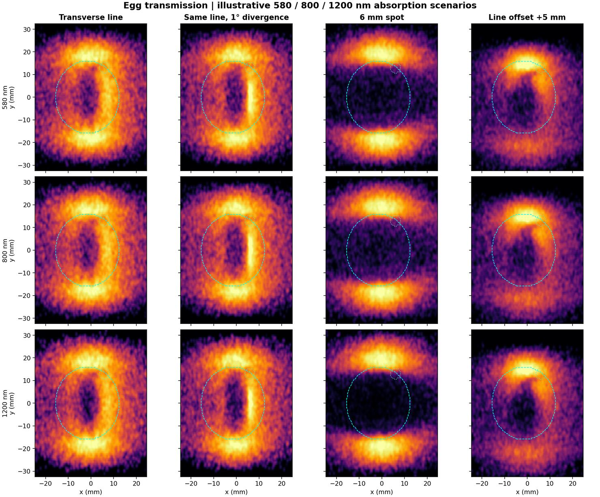
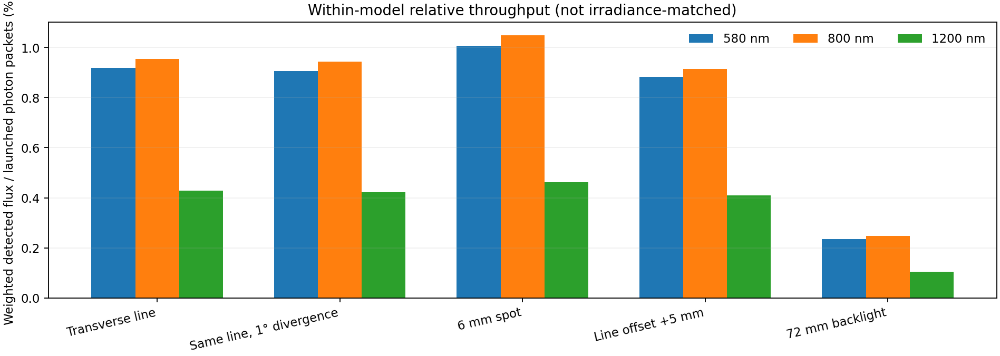

# Egg transmission: critical review and three-wavelength illumination comparison

**19 November 2026 · Python/Numba prototype · 112 scan lines × 128 camera pixels · 18,000 launched packets/line**

> **Scientific status: hypothesis / sensitivity study, NOT validated spectral imaging.** Only the 800 nm albumen/yolk optical properties are literature-anchored. The 580 and 1200 nm simulations use deliberately assumed *absorption multipliers*, while scattering, refractive index and camera sensitivity are held unchanged. Neither the simulated feature boundaries nor relative wavelength intensities should be taken as predictions for a physical egg.

## What the simulated camera sees



**Reading the images:** each panel is separately normalized with an asinh transform and smoothed (Gaussian σ=1.05 pixels), to reveal *spatial pattern only*. **Cyan dashed** = projected ground-truth yolk outline; **green dotted** = synthetic blood inclusion. These overlaid shapes are **not recovered from photons**. The simulation assumes an egg translating past a fixed illumination/detector line. The images are not equal-photometric-power or equal-SNR measurements.

## What the comparison actually suggests

1. **A yolk-associated shadow can be obtained, but not its exact boundary.** It is a highly distorted projection; its appearance depends on source position and source footprint. None of the configurations recovers a defensible yolk perimeter.
2. **Collimation alone is not a demonstrated win.** The second column keeps the same 2 mm stripe and changes *only* angular standard deviation from 8°/3° (x/y) to 1°/1°. At 800 nm, detected weighted flux is 0.953% versus 0.944%, and the spatial patterns are similar. The differences are smaller than warranted for claiming improved anatomical accuracy, especially with one seed and uncalibrated shell properties.
3. **A spot changes the illumination-dependent shadow much more than the collimation adjustment.** Its characteristic bright polar regions are not anatomical evidence.
4. **An offset line changes the apparent location and shape of dark regions.** This is useful optical-path diversity, but could *worsen* a naive geometrical interpretation. Treat it as an extra measurement, not a guaranteed sharpening mechanism.
5. **580 versus 1200 nm does not establish a wavelength optimum.** In our 1200 nm absorption hypothesis, weighted signal drops to about 45% of the 800 nm line reference. Independently normalized images mask this loss, and the Monte Carlo packet weights are **not** a physical camera shot/read-noise model. The blood spot still does not appear as a reliably recoverable shape at 580 nm despite strengthened *assumed* blood absorption.

## Signal comparison (simulated weighted flux)

| Illumination | 580 nm | 800 nm | 1200 nm |
|---|---:|---:|---:|
| Transverse line | 0.918% | 0.953% | 0.428% |
| Same line, lower divergence | 0.906% | 0.944% | 0.423% |
| Spot, 6 mm | 1.007% | 1.049% | 0.463% |
| Offset line, +5 mm | 0.882% | 0.915% | 0.409% |
| Broad backlight, 72 mm | 0.235% | 0.249% | 0.104% |



Signal = weight accepted by the idealized camera ÷ launched packet weight, averaged over all scan lines. It is **not** detector DN, SNR, calibrated transmission, or light output per lamp watt. In particular, the wide-area backlight uses the *same total packet count* spread across a larger footprint, so its smaller signal must **not** be read as inherently worse efficiency at matched irradiance.

## Basic Monte Carlo repeatability check (800 nm)

The same two line configurations were repeated at **seed 712** rather than 711, using identical photon counts and geometry:

| Seed | 2 mm transverse line | Same-width, lower-divergence line |
|---|---:|---:|
| 711 | 0.9532% | 0.9437% |
| 712 | 0.9354% | 0.9502% |

**The ordering reverses between independent seeds.** Thus even the apparent ~1% throughput advantage of one setting in a single run is **not robust enough to claim a meaningful collimation effect**. The 2-pixel-smoothed repeated-seed image correlations were approximately 0.988 and 0.989, but this does not establish morphological accuracy. The detailed check is in [`convergence_seed712.json`](three_wavelengths/convergence_seed712.json). For rigorous uncertainty estimates, run considerably more seeds/photons and ideally use variance-reduced Monte Carlo methods.

## Optical assumptions — explicitly not measured spectra

| Material | μₐ at 800 nm (mm⁻¹) | Multiplier at 580 nm | Multiplier at 1200 nm |
|---|---:|---:|---:|
| Shell | 0.040 *(illustrative)* | ×1.25 | ×1.20 |
| Albumen | 0.006 *(literature-anchored at 800 nm)* | ×1.00 | ×5.00 |
| Yolk | 0.014 *(literature-anchored at 800 nm)* | ×1.80 | ×4.00 |
| Blood spot | 0.700 *(illustrative)* | ×4.00 | ×0.90 |

All μₛ, g and n values are identical to the repository's 800 nm baseline at every wavelength. The purpose is a **controlled absorption sensitivity analysis**, not a guessed full spectrum. The 580 nm choice is motivated by hemoglobin-sensitive detection in the egg literature; 1200 nm probes a SWIR region influenced by water/lipid absorption but is not specifically established as optimal for geometric imaging.

## Critical assessment and highest-priority fixes

| Issue | Why it matters | Proposed next step |
|---|---|---|
| **Eggshell is a smooth, low-scattering placeholder** | Shell/membrane roughness and diffuse internal recirculation may dominate actual blur; published eggshell optical models show very different effective scattering descriptions | Replace with measured shell scattering/reflectance and shell-colour-specific models; benchmark against shell-only measurements |
| **No true wavelength-dependent material curves** | 580/1200 nm contrasts are determined by our chosen multipliers | Import measured μₐ(λ), μₛ(λ), g(λ), n(λ) from double integrating sphere / IAD, where available; do not extrapolate |
| **No measured illumination or camera transfer** | SCHOTT fibre line width, divergence, spectral power, lens pupil and detector QE are absent | Measure line width/irradiance at several heights, actual angular emission and a through-system white reference |
| **Photon weights ≠ camera SNR** | Brighter normalized images can hide large signal losses; no Poisson/read-noise model | Convert weighted flux to calibrated electrons and model exposure, full-well and read noise |
| **Limited two-seed repeatability; slight path truncation** | Even the line/collimation throughput ranking reverses for independent seeds; a fraction of trajectories hits 900-event cap | Repeat with independent seeds and higher packet counts; examine max-event and geometry convergence |
| **Custom Numba kernel not independently validated** | Refraction, boundary bookkeeping and complex shell transport could be biased | Benchmark against open-source MCX or PyXOpto and empirical shell/egg phantoms |

**Lab recommendation:** Test your existing transverse SCHOTT line first at 580, 800 and 1200 nm. Change **only** its divergence/focus for a controlled comparison, then try 5 mm source offset as an additional acquisition. Match incident irradiance on the lower egg shell and compare repeat-scan contrast at fixed detector noise. For geometric truth, compare with an opened egg or MRI, *not* with the intensity silhouette alone.

## Reproduce

```bash
python -m pip install -r requirements.txt
python scripts/compare_three_wavelengths.py --photons 18000 --lines 112 --pixels 128
python scripts/check_convergence.py  # second seed, 800 nm, uses output NPZ files
pytest -q
```

The main script outputs all 15 raw arrays (`*.npz`), `summary.json`, the four-source pattern figure and five-source flux chart. The broad-light image is deliberately left out of the main panel to avoid conflating radiometry with spatial pattern. The previous [eight-configuration 800 nm study](illumination_comparison_800nm.md) remains archived for additional exploratory settings.

## Sources

- [Tamura et al. (2026), *Light propagation in an intact egg*](https://doi.org/10.1016/j.jfoodeng.2026.113182): bulk optical-property measurements for albumen and yolk over parts of 500–1000 nm; project takes the specified 800 nm coefficients.
- [Li et al. (2026), *Dual-wavelength filtering for detection of blood-spotted eggs*](https://doi.org/10.1007/s11694-026-04824-7): 580 nm blood-sensitive, 630 nm reference; wavelength choice, **not** quantitative input optical coefficients.
- [Eggshell pigmentation, reflectance and transmittance (2019)](https://doi.org/10.1002/open.201900154): demonstrates substantial shell scattering/absorption and strong pigment dependence; its effective coefficients must not be substituted directly into a volume HG model without matching definitions.
- [Damagatla et al. (2026), shell-induced integrating-sphere behavior](https://www.sciencedirect.com/science/article/pii/S2950636026001568): supporting evidence that intact-shell photon transport is unusually complex.
- [SWIR tissue optical-property review](https://pmc.ncbi.nlm.nih.gov/articles/PMC4370890/): 1200 nm water/lipid-associated spectral features motivate a cautious SWIR scenario.
- [MCX](https://github.com/fangq/mcx) and [PyXOpto](https://github.com/xopto/pyxopto): recommended mature independent transport benchmarks.